<div align="center">


# Opalite

**Notas em Markdown, documentos, planilhas e apresentações — tudo local, numa pasta sua.**

[](https://opalite.rodrigo1miller.workers.dev/)
[](https://github.com/rodrigomillerdev/opalite/releases/latest)


[**Site**](https://opalite.rodrigo1miller.workers.dev/) ·
[**Baixar**](https://github.com/rodrigomillerdev/opalite/releases/latest) ·
[**Funcionalidades**](#-funcionalidades) ·
[**Demonstrações**](#-demonstrações) ·
[**Tecnologias**](#-tecnologias) ·
[**Desenvolvimento**](#-desenvolvimento)

<br />

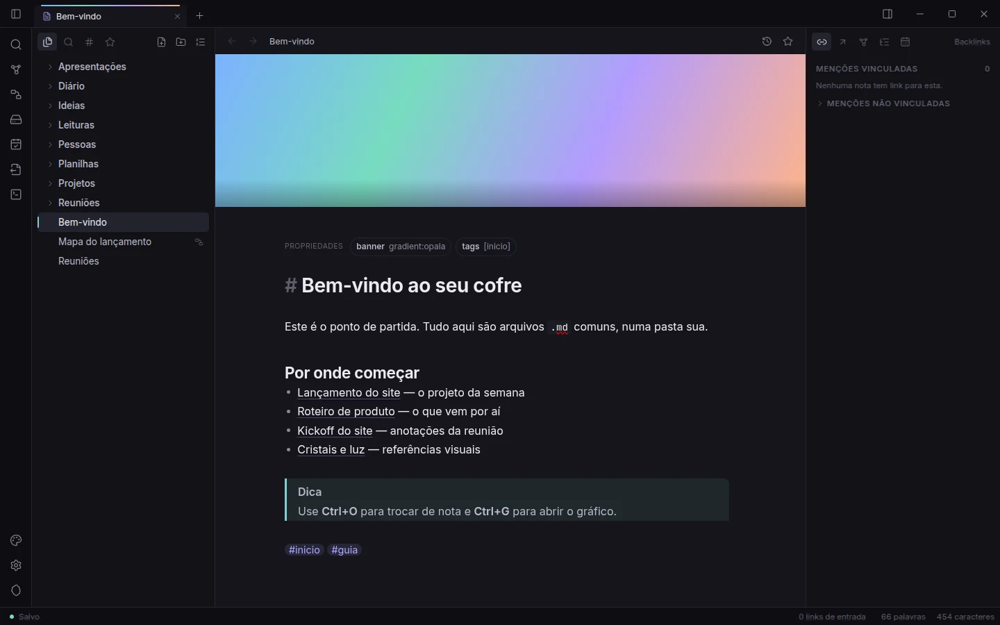

</div>

---

## Sumário

- [O que é](#-o-que-é)
- [Funcionalidades](#-funcionalidades)
- [Demonstrações](#-demonstrações)
- [Capturas de tela](#-capturas-de-tela)
- [Download e instalação](#-download-e-instalação)
- [Tecnologias](#-tecnologias)
- [Arquitetura](#-arquitetura)
- [Desenvolvimento](#-desenvolvimento)
- [Atalhos](#-atalhos)
- [Guia completo](#-guia-completo)
- [Estrutura do projeto](#-estrutura-do-projeto)
- [Roteiro](#-roteiro)
- [Licença e autor](#-licença-e-autor)

---

## 💎 O que é

A opala deixa a luz passar e a devolve em cores. O **Opalite** faz o mesmo com o que você pensa:
recebe notas soltas, documentos e referências — e devolve conexões claras.

É um app de desktop para **notas em Markdown** que também **edita documentos (.docx), planilhas
(.xlsx/.csv) e apresentações (.pptx)**, lê **PDFs em modo livro**, **converte arquivos** entre
formatos e mostra como tudo se conecta num **gráfico**. Um *cofre* é só uma pasta do seu
computador: as notas são arquivos `.md` comuns, legíveis em qualquer editor.

- **Local-first:** nada é enviado para a internet e não há conta para criar.
- **Formatos abertos:** Markdown, JSON Canvas, .docx, .xlsx e .pptx. Nada fica preso ao app.
- **Tudo em um lugar:** notas, documentos, planilhas, slides, PDFs e canvas abrem lado a lado, em abas.
- **Desenvolvimento próprio (clean-room):** sem código de outros editores.

---

## ✨ Funcionalidades

| | |
|---|---|
| 📝 **Notas em Markdown** | Live preview, `[[links]]` com autocompletar, backlinks, tags, propriedades (frontmatter), tarefas, realces coloridos, equações (KaTeX), destaques, notas de rodapé e capas. |
| 🕸️ **Gráfico de conexões** | Cada nota vira uma esfera colorida pela pasta ou tag. Arraste, aproxime e abra com um clique. Também há o gráfico local da nota aberta. |
| 🧩 **Canvas** | Cartões de texto, notas do cofre, links e grupos ligados por setas num quadro infinito, no formato aberto JSON Canvas. |
| 📄 **Documentos (.docx)** | Folha A4, estilos de título, fontes, cores, listas, tabelas, imagens redimensionáveis e links, com contagem de páginas e palavras. |
| 📊 **Planilhas (.xlsx/.csv)** | Fórmulas em português ou inglês (`=SOMA`, `=PROCV`, `=SE`…), formatos de número brasileiros, abas, classificar e copiar/colar com o Excel. |
| 🎞️ **Apresentações (.pptx)** | Slides com layouts, caixas de texto, formas e imagens; fonte, espaçamento, listas, fundo, borda, opacidade e rotação; modo apresentação em tela cheia (F5). |
| 🔁 **Conversor de arquivos** | PDF ⇄ DOCX, nota → PDF/HTML/DOCX, XLSX ⇄ CSV, PPTX → PDF e imagens entre PNG, JPG, WebP, BMP e GIF. Tudo local; o original nunca muda. |
| 📖 **Leitor de PDF em modo livro** | Duas páginas lado a lado e animação 3D de virar a página. Também modo rolagem, zoom e tela cheia. |
| 📅 **Calendário e notas diárias** | Um arquivo `AAAA-MM-DD.md` por dia; o calendário marca os dias com nota e mostra quais notas citam o dia escolhido. |
| ⌨️ **Paleta de comandos e busca** | Ctrl+P para qualquer comando, Ctrl+O para trocar de nota e busca em todo o cofre com filtros (`tag:`, `path:`, `"frase"`). |
| 🕒 **Histórico de versões** | Cópias em `.opalite/history` antes de sobrescrever documentos e, nas notas, a cada 10 minutos de edição. Veja e restaure. |
| 🎨 **Temas e editor de cores** | Opala Negra, Branca e de Fogo; ou crie o seu com até 3 cores, harmonias, textura e intensidade — o texto continua legível. |

---

## 🎬 Demonstrações

Gravações reais do app (sem cortes nem efeitos), com um cofre de exemplo.
Também dá para assistir em melhor qualidade [no site](https://opalite.rodrigo1miller.workers.dev/#demo).

<table>
  <tr>
    <td width="50%" valign="top">
      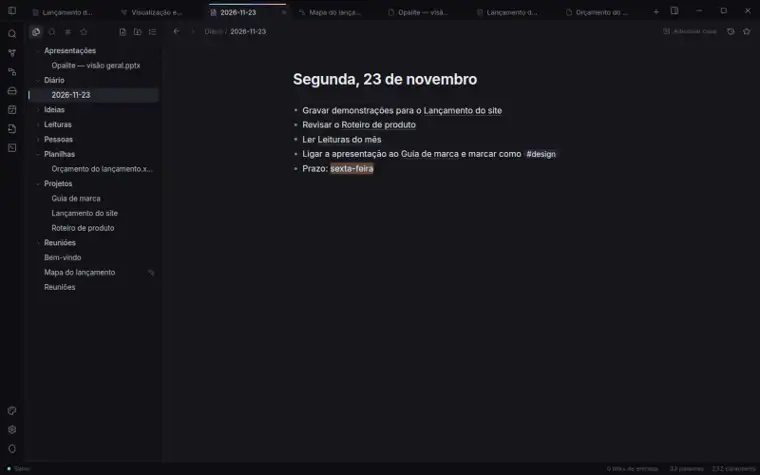
      <p align="center"><b>Escrever e ligar notas</b><br/><sub>Um link com <code>[[ ]]</code> e o autocompletar, uma tag e um realce — tudo Markdown.</sub></p>
    </td>
    <td width="50%" valign="top">
      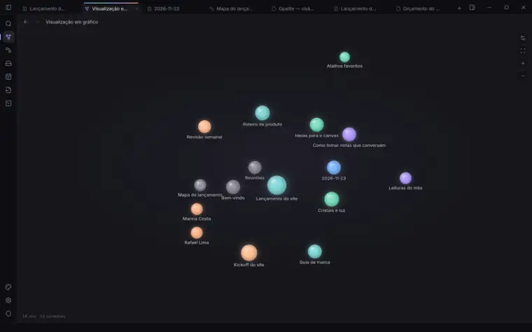
      <p align="center"><b>Explorar o gráfico</b><br/><sub>Passe o mouse para ver as conexões, arraste uma nota e use o zoom.</sub></p>
    </td>
  </tr>
  <tr>
    <td width="50%" valign="top">
      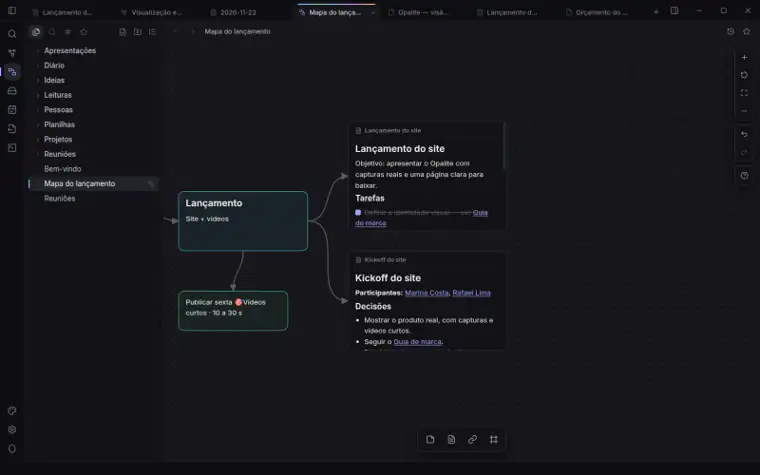
      <p align="center"><b>Organizar no canvas</b><br/><sub>Arraste cartões e crie um novo com duplo clique.</sub></p>
    </td>
    <td width="50%" valign="top">
      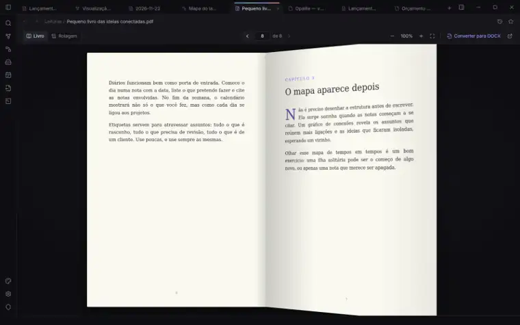
      <p align="center"><b>Ler como um livro</b><br/><sub>Duas páginas lado a lado, e a página vira com animação.</sub></p>
    </td>
  </tr>
  <tr>
    <td width="50%" valign="top">
      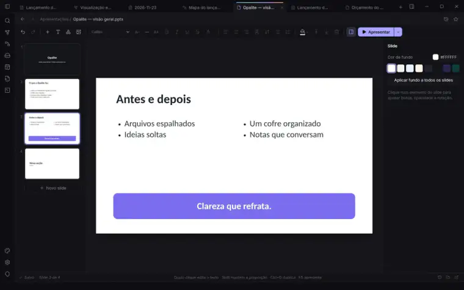
      <p align="center"><b>Editar uma apresentação</b><br/><sub>Selecione uma caixa, troque marcadores por numeração e navegue pelos slides.</sub></p>
    </td>
    <td width="50%" valign="top">
      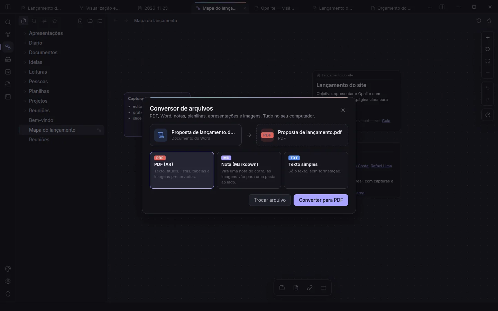
      <p align="center"><b>Converter arquivos</b><br/><sub>Escolha o arquivo e o formato de destino; o original nunca muda.</sub></p>
    </td>
  </tr>
</table>

---

## 🖼️ Capturas de tela

<table>
  <tr>
    <td>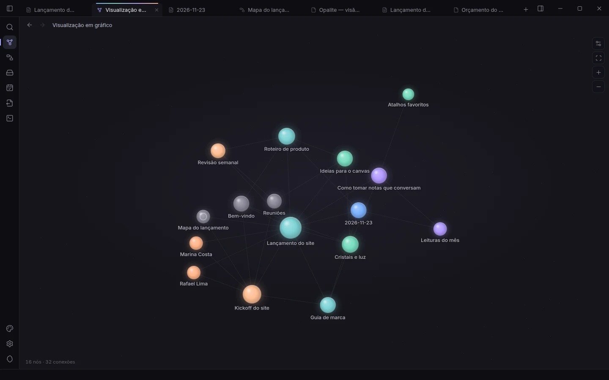<p align="center"><sub>Gráfico de conexões</sub></p></td>
    <td>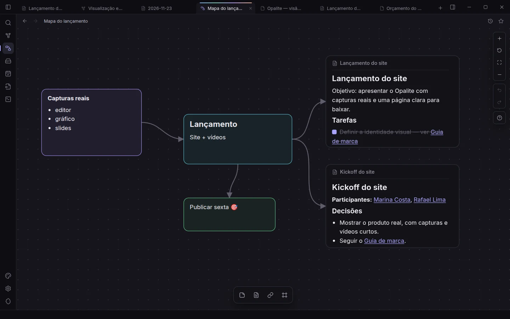<p align="center"><sub>Canvas</sub></p></td>
  </tr>
  <tr>
    <td>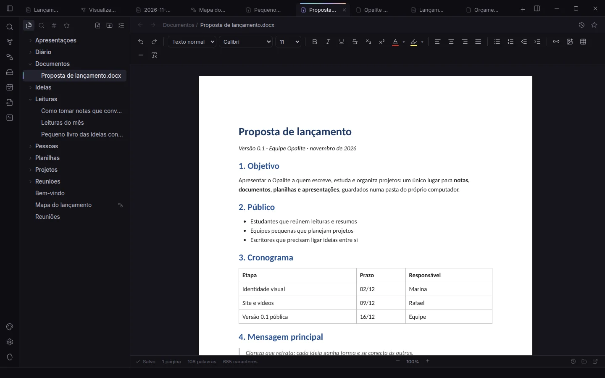<p align="center"><sub>Documentos do Word (.docx)</sub></p></td>
    <td>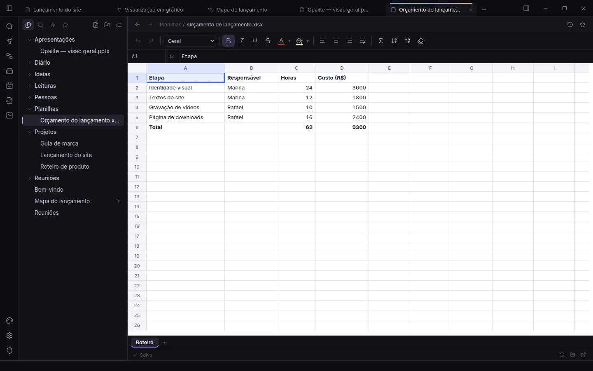<p align="center"><sub>Planilhas com fórmulas em português</sub></p></td>
  </tr>
  <tr>
    <td>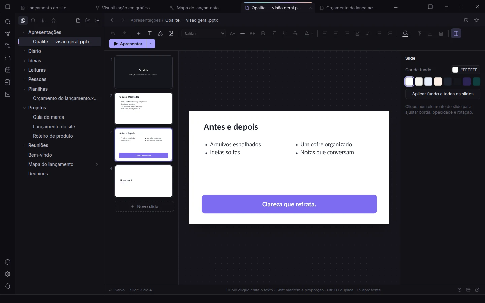<p align="center"><sub>Apresentações (.pptx)</sub></p></td>
    <td>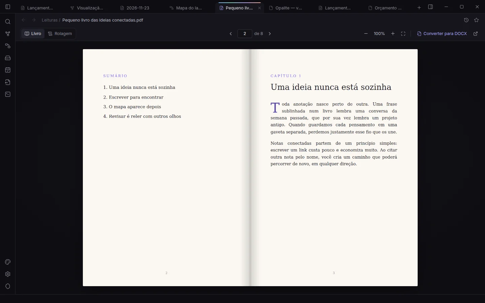<p align="center"><sub>Leitor de PDF em modo livro</sub></p></td>
  </tr>
  <tr>
    <td>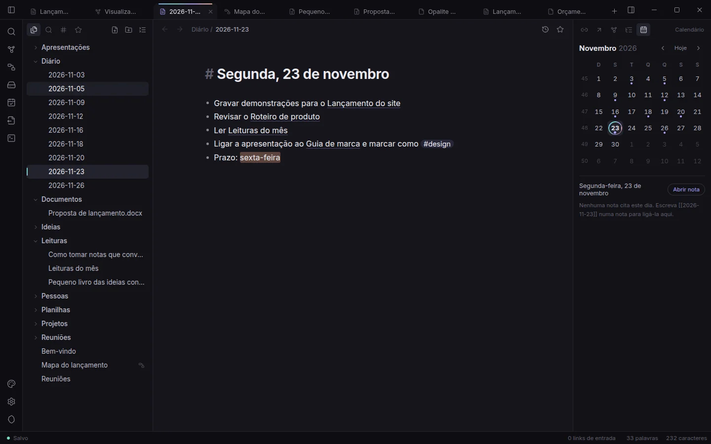<p align="center"><sub>Calendário e notas diárias</sub></p></td>
    <td>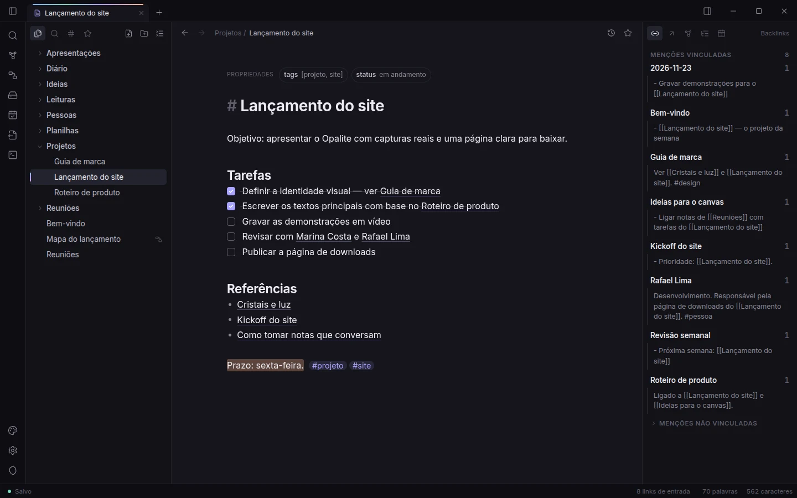<p align="center"><sub>Tarefas e backlinks</sub></p></td>
  </tr>
  <tr>
    <td>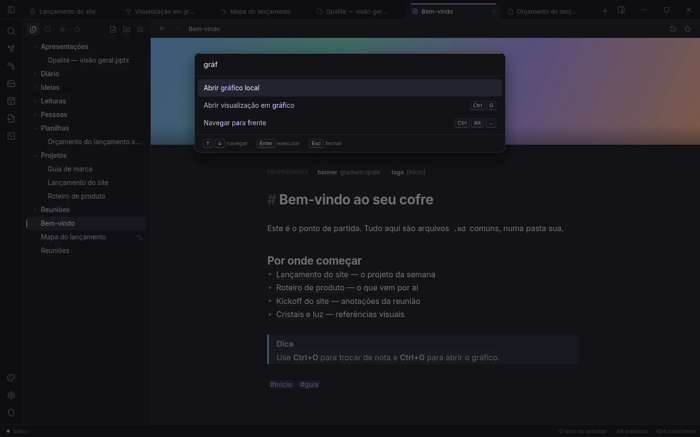<p align="center"><sub>Paleta de comandos</sub></p></td>
    <td>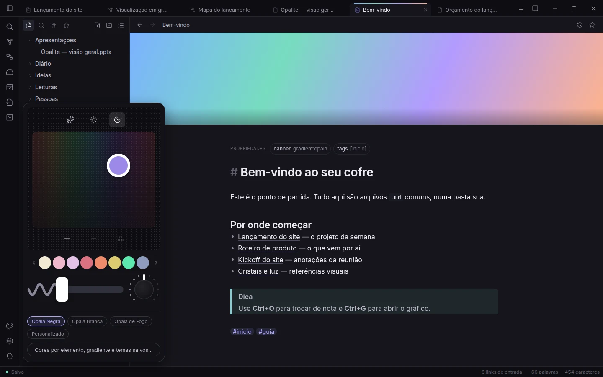<p align="center"><sub>Editor de tema</sub></p></td>
  </tr>
  <tr>
    <td colspan="2">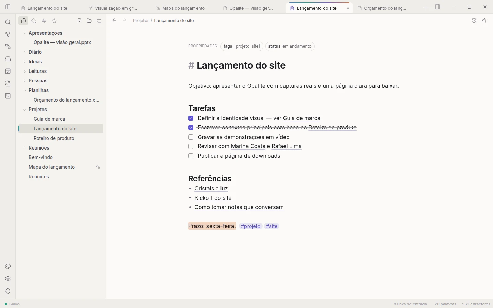<p align="center"><sub>Tema claro Opala Branca</sub></p></td>
  </tr>
</table>

---

## ⬇️ Download e instalação

Baixe a versão mais recente na página de [**Releases**](https://github.com/rodrigomillerdev/opalite/releases/latest).

| Sistema | Arquivo | Como instalar |
|---|---|---|
| Ubuntu, Debian, Mint, Pop!_OS | `opalite_0.1.0_amd64.deb` | `sudo apt install ./opalite_0.1.0_amd64.deb` |
| Qualquer Linux (x64) | `opalite-0.1.0-linux-x64.tar.gz` | Extraia e rode `./instalar.sh` (só para o seu usuário, sem administrador) |
| Windows (64 bits) | `opalite-0.1.0-windows-x64.zip` | Extraia e dê dois cliques em **Instalar Opalite.cmd** |

**Linux (.deb):** o app vai para `/opt/opalite`, aparece no menu de aplicativos e abre pelo terminal
com `opalite`.
**Linux (.tar.gz):** `./desinstalar.sh` remove; também dá para rodar `Opalite/opalite` direto, sem instalar.
**Windows:** também dá para abrir `Opalite\Opalite.exe` direto, sem instalar. Não precisa de administrador.

Para conferir os arquivos baixados, use o `SHA256SUMS.txt` da release:

```bash
sha256sum -c SHA256SUMS.txt
```

> Ainda não há versão empacotada para macOS. A interface do app é em português.

---

## 🧰 Tecnologias

### Linguagens

| Linguagem | Onde é usada | Linhas | Proporção |
|---|---|---:|---:|
| **TypeScript** (TS/TSX) | Todo o app: processo principal, ponte (preload), interface React, editores, conversores e testes | ~25.900 | 73 % |
| **CSS** (CSS Modules) | Estilos de cada componente, temas e tokens de design | ~8.750 | 25 % |
| **JavaScript** (Node, CommonJS) | Scripts de empacotamento para Linux e Windows e geração dos ícones | ~420 | 1 % |
| **PowerShell** | Instalador por usuário e atalhos no Windows | ~160 | < 1 % |
| **Shell (Bash)** | Instalador e desinstalador do pacote `.tar.gz` no Linux | ~75 | < 1 % |
| **Batch (.cmd)** e **HTML** | Atalhos "Instalar/Desinstalar Opalite" no Windows; página base da interface | ~30 | < 1 % |

O app inteiro roda em **uma linguagem só** (TypeScript), do processo principal à interface —
o que permite reaproveitar código entre eles (parser de links, tipos compartilhados).

### Plataforma e base

| Tecnologia | Para quê |
|---|---|
| [Electron 38](https://www.electronjs.org/) | App de desktop multiplataforma (Chromium + Node.js) |
| [React 19](https://react.dev/) | Interface |
| [TypeScript 5.9](https://www.typescriptlang.org/) | Tipagem estática em todo o código |
| [electron-vite](https://electron-vite.org/) + [Vite 7](https://vite.dev/) | Build e recarregamento rápido em desenvolvimento |
| [Zustand](https://github.com/pmndrs/zustand) | Estado da interface (cofre, abas, índice) |
| CSS Modules | Estilos isolados por componente, com tokens de tema |

### Editor e notas

| Biblioteca | Para quê |
|---|---|
| [CodeMirror 6](https://codemirror.net/) | Editor de Markdown com live preview, autocompletar e busca |
| [Lezer](https://lezer.codemirror.net/) (`@lezer/markdown`) | Análise do Markdown (wikilinks, realces, destaques) |
| [KaTeX](https://katex.org/) | Equações matemáticas |
| [MiniSearch](https://lucaong.github.io/minisearch/) | Busca de texto completo no cofre |
| [yaml](https://eemeli.org/yaml/) | Propriedades (frontmatter) das notas |
| [chokidar](https://github.com/paulmillr/chokidar) | Observar mudanças feitas fora do app na pasta do cofre |

### Gráfico, documentos e conversões

| Biblioteca | Para quê |
|---|---|
| [d3-force](https://d3js.org/d3-force) | Simulação física do gráfico de conexões |
| [docx](https://docx.js.org/) | Gravação de documentos do Word (.docx) |
| [mammoth](https://github.com/mwilliamson/mammoth.js) | Leitura de .docx vindos de outros programas |
| [PDF.js](https://mozilla.github.io/pdf.js/) (`pdfjs-dist`) | Leitor de PDF e conversões a partir de PDF |
| [fflate](https://github.com/101arrowz/fflate) | Ler e gravar os pacotes ZIP do Office (.xlsx, .pptx) |
| Código próprio | Planilhas (.xlsx) e fórmulas, apresentações (.pptx), modo livro e o conversor |

### Interface e tipografia

| Recurso | Para quê |
|---|---|
| [Lucide](https://lucide.dev/) | Ícones |
| [Inter](https://rsms.me/inter/) e [JetBrains Mono](https://www.jetbrains.com/lp/mono/) (Fontsource) | Fontes da interface e do código, embutidas no app |

### Ferramentas de desenvolvimento

| Ferramenta | Para quê |
|---|---|
| [Vitest](https://vitest.dev/) | 176 testes automatizados (Markdown, links, Office, fórmulas, conversões) |
| `tsc` | Verificação de tipos do processo principal e da interface |
| Scripts próprios (`scripts/`) | Empacotamento `.deb`, `.tar.gz` e `.zip` com instaladores, e geração dos ícones |
| Git | Controle de versão |

---

## 🏗️ Arquitetura

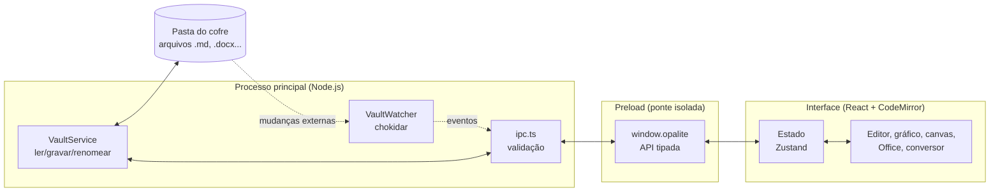

Princípios:

1. **Local-first.** O cofre é uma pasta comum. Índices (busca, backlinks) são *derivados* dos
   arquivos e podem ser reconstruídos a qualquer momento.
2. **O disco pertence ao processo principal.** A interface nunca toca no sistema de arquivos:
   ela pede por IPC, com caminhos relativos, e o processo principal valida tudo.
3. **Clean-room.** Só comportamento observável e padrões abertos (CommonMark/GFM, frontmatter
   YAML, wikilinks).
4. **Desempenho é requisito.** O editor vive fora do React; listas e índices são incrementais.

Detalhes em [docs/ARCHITECTURE.md](docs/ARCHITECTURE.md).

---

## 🛠️ Desenvolvimento

**Requisitos:** Node.js 22 ou mais recente.

```bash
git clone https://github.com/rodrigomillerdev/opalite.git
cd opalite
npm install
npm run dev
```

| Comando | O que faz |
|---|---|
| `npm install` | Instala as dependências |
| `npm run dev` | Abre o app em modo desenvolvimento (recarrega ao salvar; F12 abre o DevTools) |
| `npm test` | Roda os testes (Vitest) |
| `npm run typecheck` | Verifica os tipos do TypeScript |
| `npm run build` | Gera a versão otimizada em `out/` |
| `npm start` | Abre a versão gerada pelo build |
| `npm run package:linux` | Gera a versão para Linux em `dist/`: pasta, `.tar.gz` com instalador e `.deb` (rode no Linux) |
| `npm run package:win` | Gera a versão para Windows em `dist/`: pasta e `.zip` com instalador |
| `npm run brand:icons` | Regenera os ícones (`.ico` e PNGs, inclusive os do Linux) a partir de `assets/brand/opalite-icon-source.jpg` |
| `npm run desktop:shortcuts` | (Windows) Gera o build e cria atalhos na área de trabalho e no Menu Iniciar |

O app lembra o último cofre aberto e reabre nele.

---

## ⌨️ Atalhos

| Ação | Atalho |
|---|---|
| Paleta de comandos | Ctrl+P |
| Troca rápida de notas (Shift+Enter cria) | Ctrl+O |
| Buscar em todas as notas | Ctrl+Shift+F |
| Visualização em gráfico | Ctrl+G |
| Arquivos (gerenciador) | Ctrl+Shift+E |
| Voltar / avançar | Ctrl+Alt+← / Ctrl+Alt+→ (ou botões laterais do mouse) |
| Nova nota / nova pasta | Ctrl+N / Ctrl+Shift+N |
| Nova aba / fechar / reabrir / alternar | Ctrl+T / Ctrl+W / Ctrl+Shift+T / Ctrl+Tab |
| Alternar item de tarefa | Ctrl+L |
| Inserir link Markdown | Ctrl+K |
| Negrito, itálico, tachado, código | Ctrl+B, Ctrl+I, Ctrl+Shift+X, Ctrl+E |
| Buscar e substituir na nota | Ctrl+F |
| Salvar agora (o salvamento também é automático) | Ctrl+S |
| Barra lateral esquerda / direita | Ctrl+\ / Ctrl+Shift+\ |
| Renomear / mover para a lixeira (na árvore) | F2 / Delete |
| Modo apresentação (slides) | F5 |
| Tela cheia | F11 |
| Zoom da interface | Ctrl + / Ctrl − / Ctrl 0 |

---

## 📚 Guia completo

<details>
<summary><b>Área de trabalho</b></summary>

- **Abas**: notas, gráfico e canvas abrem em abas. Ctrl+clique num link, no gráfico ou na árvore
  abre em aba nova. Arraste para reordenar. As abas de cada cofre são lembradas.
- **Barra de ícones à esquerda**: troca rápida, gráfico, novo canvas, nota diária, modelos,
  conversor, paleta de comandos, nota aleatória, tema e troca de cofre.
- **Visualização em gráfico** (Ctrl+G): cada nota é uma esfera colorida pela pasta (ou pela tag).
  Arraste os nós, use a rolagem para zoom e clique para abrir. As configurações filtram tags, notas
  ainda não criadas, canvas e notas sem conexões, e ajustam tamanho, nomes e forças da simulação.
  O **gráfico local** da nota atual fica na barra lateral direita.
- **Canvas** (`.canvas`, formato aberto JSON Canvas): duplo clique cria cartão de texto (Markdown);
  a barra inferior adiciona nota do cofre, link da web e grupo. Arraste os pontos laterais para
  conectar e o canto para redimensionar; cores, desfazer/refazer, zoom e enquadrar.
- **Nota diária**: um arquivo `AAAA-MM-DD.md` por dia (ícone de calendário ou paleta: hoje, ontem, amanhã).
- **Modelos**: notas da pasta `Modelos`; "Inserir modelo" troca `{{title}}`, `{{date}}`, `{{time}}`
  e `{{date:dddd, DD/MM}}`.
- **Editor de tema**: modo automático/claro/escuro, até 3 cores arrastáveis num campo
  (horizontal = matiz, vertical = saturação), harmonias (análoga, complementar, tríade), amostras
  prontas, **textura** granulada e **intensidade** da cor. O contraste do texto fica sempre legível.
- **Estúdio de temas** (Tema e cores → "Cores por elemento…"): cor de cada parte da interface em
  HEX, RGB, HSL ou nome; gradiente de 2 a 5 cores; temas salvos, exportados e importados.
- **Transições curtas** (90 a 180 ms) em abas, painéis, pastas e janelas; gráfico e canvas são
  pré-carregados em segundo plano para abrir sem espera.

</details>

<details>
<summary><b>Documentos, PDFs, calendário e capas</b></summary>

- **Arrastar e soltar** qualquer arquivo do computador: numa pasta da árvore (copia para ela), na
  nota aberta (copia para `Anexos` e incorpora `![[arquivo]]`), num canvas (vira cartão) ou em
  qualquer lugar (vai para `Anexos` e abre). Itens da própria árvore podem ser arrastados para
  outras pastas (move e atualiza os links) ou para dentro da nota (insere o link).
  Executáveis são recusados.
- **Leitor de PDF** com modo **Livro** (páginas lado a lado, capa sozinha, animação 3D de virar a
  página; clique na página ou use ← →) e modo **Rolagem**. Zoom, ir para página, abrir no app padrão.
- **Documento (.docx)**: folha A4, estilos, fontes, cores, listas, alinhamento, tabelas, imagens
  redimensionáveis e links. Documentos criados no Opalite reabrem sem perdas; os vindos de outros
  programas abrem em modo compatível (um aviso explica o que pode mudar).
- **Planilha (.xlsx / .csv)**: fórmulas em português ou inglês (`=SOMA(A1:A3)`, `=PROCV(...)`,
  `=SE(...)`…), formatos de número brasileiros, copiar/colar com o Excel, abas, classificar e
  soma/média/contagem da seleção.
- **Apresentação (.pptx)**: layouts de slide, caixas de texto, formas e imagens; fonte, tachado,
  espaçamento de linha e de letras, alinhamento vertical, marcadores e numeração; fundo do slide
  (um ou todos), borda, opacidade e rotação; modo apresentação (F5).
- **Arquivos** (Ctrl+Shift+E): gerenciador com pastas, busca, filtros por tipo, ordenação,
  favoritos, recentes, mover arrastando e detalhes com as notas que citam o arquivo.
- **Histórico de versões** (ícone de relógio): cópias em `.opalite/history` antes de sobrescrever
  documentos e, nas notas, a cada 10 minutos de edição; dá para ver e restaurar.
- **Conversor** (barra da esquerda ou clique direito no arquivo), tudo local: PDF → DOCX (texto ou
  layout fiel), Markdown, TXT e imagens das páginas; DOCX → PDF, Markdown e TXT; nota → DOCX, PDF e
  HTML; XLSX ↔ CSV e → PDF; PPTX → PDF; PNG/JPG/WebP/BMP/GIF entre si e → PDF.
- **Calendário** na barra lateral direita: um clique abre ou cria a nota do dia; mostra semanas,
  dias com nota e as notas que citam o dia selecionado.
- **Capas de nota**: "Adicionar capa" no topo da nota, galeria de gradientes opalescentes, cores,
  imagens do cofre ou enviadas; reposicionar e remover. Fica salvo no frontmatter
  (`banner:` e `banner_y:`).

</details>

<details>
<summary><b>Editor de Markdown e sintaxe</b></summary>

O botão direito no editor abre um menu próprio (navegável pelo teclado) com: links; **Formatar**
(negrito, itálico, riscado, realce em 8 cores, código, equação, comentário, limpar formatação);
**Parágrafo** (listas, tarefas, títulos 1 a 6, citação); **Inserir** (nota de rodapé, tabela,
destaque, régua, bloco de código, equação em bloco, base); e as sugestões do corretor ortográfico.

Tudo continua sendo Markdown legível em qualquer editor:

| Recurso | Como fica no arquivo |
|---|---|
| Link entre notas | `[[Nota]]`, `[[Nota#Seção]]`, `[[Nota\|apelido]]` |
| Realce padrão | `==texto==` |
| Realce colorido | `<mark style="background: rgba(...)">texto</mark>` |
| Comentário | `%%texto%%` |
| Equação | `$E = mc^2$` e blocos `$$ ... $$` (KaTeX) |
| Destaque | `> [!note] Título` (também tip, warning, danger, example, quote…) |
| Nota de rodapé | `[^1]` no texto e `[^1]: explicação` no fim |
| Imagem com tamanho | `![[foto.png\|center\|400x300]]` |
| Base (tabela viva de notas) | bloco ```` ```base ```` com `filtro:`, `colunas:`, `ordenar:` e `limite:` |

Também: **prévia de links** ao passar o mouse, **favoritos**, imagens redimensionáveis com alças e
botão de copiar nos blocos de código.

</details>

---

## 🗂️ Estrutura do projeto

```
opalite/
├── src/
│   ├── main/              Processo principal (Node.js): cofre, observador de arquivos, IPC, conversões
│   │   ├── vault/         Leitura, gravação e renomeação no disco
│   │   └── convert/       Conversões que precisam do Node (PDF, imagens)
│   ├── preload/           Ponte isolada: expõe a API tipada window.opalite
│   ├── shared/            Código usado pelos dois lados (parser de Markdown e links, tipos)
│   └── renderer/          Interface (React)
│       └── src/
│           ├── components/   Árvore, editor, gráfico, canvas, Office, conversor, diálogos
│           ├── editor/       Extensões do CodeMirror (live preview, wikilinks, realces)
│           ├── lib/          Office (.docx, .xlsx, .pptx), fórmulas, conversores, temas
│           ├── state/        Estado (Zustand)
│           └── styles/       Tokens de design e estilos globais
├── assets/brand/          Ícones do app (Windows .ico e PNGs do Linux)
├── scripts/               Empacotamento (.deb, .tar.gz, .zip) e instaladores por usuário
└── docs/                  Arquitetura e mídia deste README
```

---

## 🗺️ Roteiro

- [x] **Fase 1:** estrutura, abrir cofre, árvore de arquivos, editor com live preview, salvamento
  automático, observador de arquivos, temas
- [x] **Fase 2:** wikilinks com autocompletar, backlinks e menções não vinculadas, links de saída,
  estrutura, tags aninhadas e frontmatter, busca com filtros, paleta de comandos, troca rápida,
  histórico de navegação e atualização de links ao renomear
- [x] **Fase 3:** gráfico global e local, canvas, abas, barra de ícones, nota diária e modelos
- [x] **Office e PDFs:** editores de documentos, planilhas e apresentações, leitor de PDF em modo
  livro, conversor de arquivos, histórico de versões e calendário
- [x] **Empacotamento:** Linux (`.deb`, `.tar.gz`) e Windows (`.zip` com instalador)
- [ ] Painéis divididos lado a lado
- [ ] **Fase 4:** painel de IA (Facetas) com um provedor e streaming
- [ ] **Fase 5:** ferramentas da IA com confirmação, demais provedores
- [ ] **Fase 6:** RAG com embeddings
- [ ] **Fase 7:** API de plugins
- [ ] Versão para macOS

---

## 📄 Licença e autor

Distribuído sob a licença **MIT** — veja [LICENSE](LICENSE).

Desenvolvido por **Rodrigo Miller** · [GitHub](https://github.com/rodrigomillerdev) ·
[Site do Opalite](https://opalite.rodrigo1miller.workers.dev/)

<div align="center">
<br />

<br />
<sub>Clareza que refrata.</sub>
</div>
