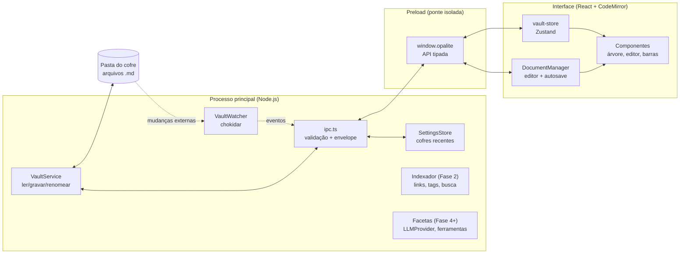

# Arquitetura do Opalite

Este documento descreve como o Opalite é organizado. Ele cresce a cada fase.

## Princípios

1. **Local-first.** O cofre é uma pasta comum com arquivos `.md`. Não há banco de
   dados como fonte da verdade: índices (busca, backlinks, embeddings) são
   *derivados* dos arquivos e podem ser apagados e reconstruídos a qualquer momento.
2. **O disco pertence ao processo principal.** A interface nunca toca no sistema de
   arquivos; ela pede por IPC, com caminhos relativos, e o main valida tudo.
3. **Clean-room.** Só comportamento observável e padrões abertos (CommonMark/GFM,
   YAML frontmatter, wikilinks). Nenhum código de terceiros proprietário.
4. **Desempenho é requisito.** O editor vive fora do React; listas e índices são
   incrementais; o bundle é medido a cada fase.

## Por que Electron (e não Tauri)

A sugestão inicial era Tauri 2. Escolhemos Electron por três motivos concretos:

- A máquina de desenvolvimento não tem Rust nem o MSVC Build Tools, e o
  **Smart App Control** do Windows 11 está ligado. Ele costuma bloquear executáveis
  recém-compilados sem assinatura, como os do build do Rust, e desligá-lo é irreversível.
- O app inteiro fica em **uma linguagem só** (TypeScript), o que ajuda no aprendizado
  e permite reaproveitar código entre main e interface (parser de links, tipos).
- O ecossistema Node tem tudo de que as fases futuras precisam: `chokidar`
  (observador de arquivos), SDKs oficiais de IA, `safeStorage` para chaves de API
  (usa DPAPI no Windows e Keychain no macOS) e SQLite.

O custo é um app maior (~100 MB contra ~10 MB) e mais memória. Para um editor de
notas, é uma troca aceitável.

## Visão geral dos processos



### Segurança da janela

- `contextIsolation: true`, `sandbox: true`, `nodeIntegration: false`: a página não
  tem acesso ao Node. Só enxerga as funções expostas em `window.opalite`.
- CSP restrita em `index.html`: só scripts empacotados com o app.
- Navegação bloqueada; links externos abrem no navegador do sistema.
- `paths.ts` impede que qualquer caminho saia do cofre (`..`, letras de unidade,
  links simbólicos que apontam para fora).
- Reabrir cofre por IPC só funciona para pastas que a pessoa já escolheu no diálogo.

## Estrutura de pastas

```
opalite/
├─ docs/ARCHITECTURE.md        este documento
├─ electron.vite.config.ts     build dos três alvos
├─ src/
│  ├─ shared/                  código e tipos usados por main E interface
│  │  ├─ types.ts              contrato da API (OpaliteApi), TreeNode, VaultEvent
│  │  └─ ipc.ts                nomes dos canais IPC
│  ├─ main/                    processo principal
│  │  ├─ index.ts              janela, ciclo de vida, cofre inicial
│  │  ├─ ipc.ts                handlers (validação, diálogos, menus nativos)
│  │  ├─ settings.ts           preferências do app (%APPDATA%/Opalite)
│  │  └─ vault/
│  │     ├─ paths.ts           fronteira de segurança + nomes de arquivo
│  │     ├─ tree.ts            leitura recursiva da árvore
│  │     ├─ vault-service.ts   operações de disco (escrita atômica)
│  │     └─ watcher.ts         observador de arquivos com lotes
│  ├─ preload/index.ts         expõe window.opalite
│  └─ renderer/
│     ├─ index.html            CSP
│     └─ src/
│        ├─ App.tsx            boas-vindas ou área de trabalho
│        ├─ components/        TitleBar, Sidebar, FileTree, EditorPane, StatusBar...
│        ├─ editor/            CodeMirror: extensões, tema, live preview, DocumentManager
│        ├─ state/             stores Zustand
│        ├─ lib/               utilitários puros (temas, caminhos, contagem)
│        └─ styles/            tokens.css (3 temas) e global.css
```

Fases futuras adicionam, principalmente:

```
src/shared/markdown/     parser de wikilinks, tags e frontmatter (Fase 2; usado nos dois lados)
src/main/index/          indexador, busca, backlinks (Fase 2) e embeddings (Fase 6)
src/main/ai/             LLMProvider, provedores, ferramentas, log de ações (Fases 4-5)
src/main/plugins/        carregador e API de plugins (Fase 7)
src/renderer/src/features/  graph/, search/, palette/, facets/ (painel de IA)
<cofre>/.opalite/        config por cofre, workspace, cache de índice, histórico de chat
```

## Modelo de dados

### Fase 1 (implementado)

| Tipo | Campos | Onde |
|---|---|---|
| `VaultInfo` | `root` (absoluto), `name` | main → interface |
| `TreeNode` | `kind`, `path` (relativo, `/`), `name`, `title` ou `children` | `vault:tree` |
| `FileContent` | `path`, `content`, `mtimeMs` | `file:read` |
| `VaultEvent` | `type` (add, change, unlink, addDir, unlinkDir), `path` | `vault:events` |

**Identidade de uma nota = caminho relativo** (`Projetos/Ideias.md`). O título exibido
é o nome do arquivo sem `.md`, como em qualquer gerenciador de arquivos.

### Fase 2 (implementado)

- `src/shared/markdown/parse.ts`: extrai wikilinks, tags, títulos, apelidos e frontmatter.
  Antes da busca por padrões, o código (blocos e inline) e o frontmatter são trocados
  por espaços (`maskCode`), preservando as posições: `[[x]]` dentro de código não vira link.
- `src/shared/markdown/resolve.ts`: `LinkResolver`, usado no main (índice) e na interface
  (cor dos links, autocompletar, links de saída).
- `src/main/index/vault-index.ts`: índice em memória com MiniSearch (busca de texto
  completo sem acentos), backlinks, menções não vinculadas, contagem de tags e
  `computeRenameEdits`, que reescreve os links quando uma nota ou pasta é renomeada.
- A interface recebe só um resumo (`NoteSummary[]`) e pede backlinks e busca por IPC.
  O evento `index:changed` (com debounce) avisa quando recarregar.
- `src/renderer/src/lib/commands.ts`: registro único de comandos. A paleta (Ctrl+P)
  lista todos, e os atalhos globais são resolvidos a partir dele.

O planejamento original abaixo continua valendo para as próximas fases.

### Planejamento do índice (referência)

```ts
interface NoteMeta {
  path: string
  title: string
  frontmatter: Record<string, unknown>   // YAML
  tags: string[]                          // "#projeto/opalite" -> ["projeto", "projeto/opalite"]
  headings: { level: number; text: string; line: number }[]
  links: LinkRef[]
  mtimeMs: number
}

interface LinkRef {
  raw: string            // "[[Nota#Seção|apelido]]"
  target: string         // "Nota"
  section?: string       // "Seção"
  alias?: string         // "apelido"
  from: number; to: number   // posição no texto
}

// Índice em memória no main, reconstruído na abertura do cofre:
//   notes:      Map<path, NoteMeta>
//   backlinks:  Map<targetPath, Set<sourcePath>>
//   unresolved: Map<targetName, Set<sourcePath>>   (links para notas que não existem)
```

Resolução de `[[Nota]]`: primeiro o caminho exato, depois o nome de arquivo único
no cofre; empate desfeito pela nota mais próxima da origem na árvore.

Fase 6 adiciona `chunks(id, path, heading, text, embedding)` em SQLite (sqlite-vec)
dentro de `.opalite/`. Fase 4 adiciona conversas em `.opalite/facets/*.json`.

## Fluxos importantes

**Salvar.** Cada tecla marca a nota como "editando"; após 700 ms sem digitar, o
`DocumentManager` grava. A gravação é atômica (arquivo temporário oculto e depois
`rename`), então uma queda nunca deixa uma nota pela metade. Ctrl+S, trocar de nota,
trocar de janela e fechar o app forçam o salvamento imediato. Ao fechar, o main
espera a interface confirmar (até 2 s).

**Mudança externa.** O watcher agrupa eventos em lotes de 60 ms. Para a nota aberta:
se o disco tem o que acabamos de gravar, é eco e ignoramos; se a pessoa não tem
edições pendentes, recarregamos; se tem, mantemos a versão dela e mostramos
"Alterada fora do Opalite" na barra de status.

**Renomear e mover para a lixeira.** Sempre salvamos antes. Um salvamento atrasado
no caminho antigo recriaria o arquivo. Renomear nunca sobrescreve um item existente;
apagar usa a lixeira do sistema, com confirmação.
